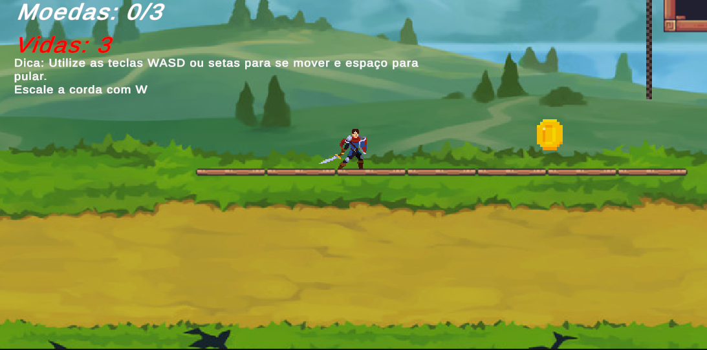
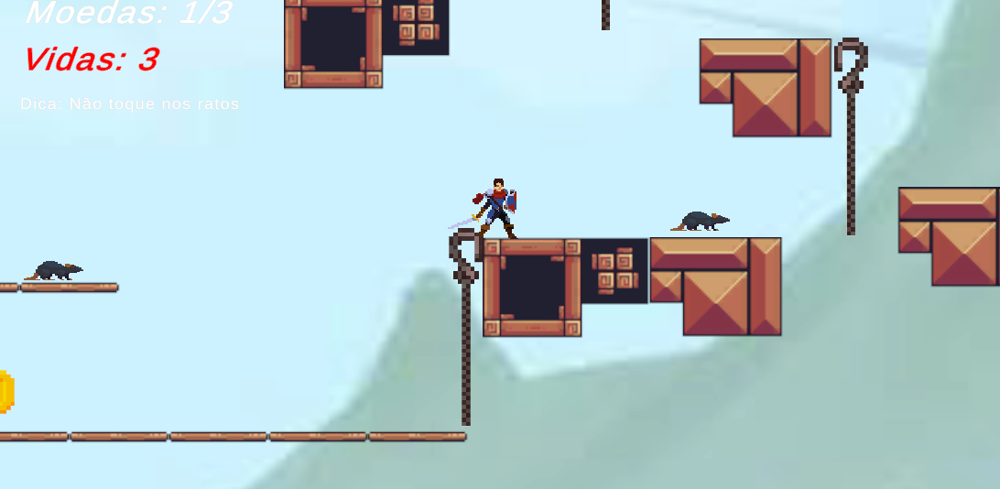
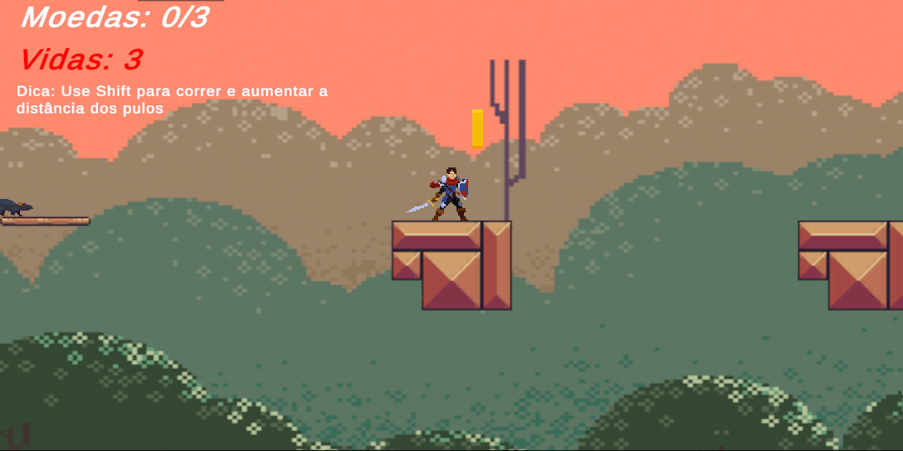
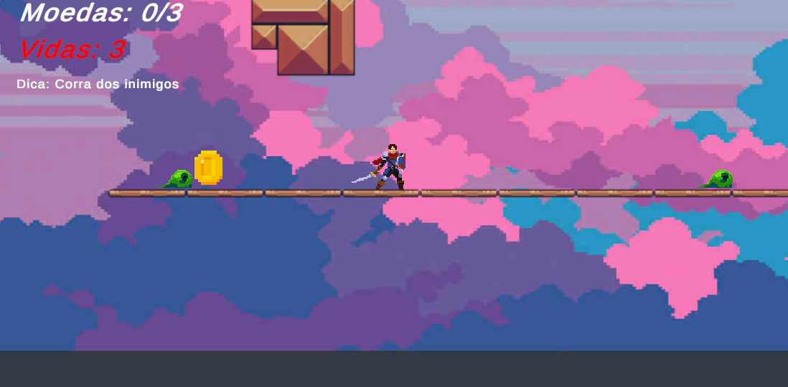

# Jogo 2D — Medieval Coin

Projeto de um jogo de plataforma 2D desenvolvido na engine **Unity 6.4** com scripts em **C#** organizados por responsabilidade técnica. O jogo combina mecânicas clássicas de movimentação com estética medieval em Pixel Art.

---

##  Sobre o Jogo

O jogador controla um cavaleiro através de 4 fases com obstáculos, plataformas de madeira/terra, escadas e criaturas hostis (ratos gigantes e cubos gelatinosos). O objetivo principal de cada fase é recolher todas as moedas espalhadas pelo cenário para desbloquear a próxima fase e concluir o jogo.

### Controle de Movimentação
* **A / D** ou **Setas Laterais**: Caminhada (`walkSpeed = 4`)
* **Shift (Manter pressionado)**: Correr (`runSpeed = 6.5`)
* **Espaço**: Pular (`jumpForce = 8` com verificação de solo via `Physics2D.OverlapCircle`)
* **W / S** ou **Setas Verticais**: Subir e descer escadas (`climbSpeed = 4`)
* **R**: Reiniciar a fase atual manualmente

---

---

## Fases

### Fase 1 — Introdução

- Apresenta o jogador ao jogo, às suas mecânicas básicas e o objetivo.

### Fase 2 — Inimigos

- Apresenta ao jogador inimigos que devem ser evitados.

### Fase 3 — Desafio

- Demonstra a necessidade de usar a mecânica de correr e aproveitar a velocidade para alcançar plataformas distantes.

### Fase 4 — Desafio Final

- Apresenta ao jogador novos inimigos que devem ser evitados e possuem a mecânica de perseguir, o jogador deve utilizar as mecânicas aprendidas nas fases anteriores.
---


##  Tecnologias e Arquitetura de Código

* **Engine:** Unity 6.6 (2D)
* **Linguagem:** C# (.NET)
* **Interface:** TextMeshPro (TMP)
* **Física:** Rigidbody2D, BoxCollider2D, CircleCollider2D, Physics2D.OverlapCircle

###  Estrutura de Scripts (`Assets/Scripts/`)
* **`GameManager.cs`**: Gerenciador global baseado no padrão *Singleton* (`DontDestroyOnLoad`). Controla a contagem de moedas da fase via `FindObjectsByType<Coin>()`, o sistema de 3 vidas, a transição de cenas, a reprodução contínua da música de fundo (BGM em loop) e a exibição dinâmica dos painéis de interface (`WinPanel` e `GameOverPanel`).
* **`PlayerController.cs`**: Controla toda a física e entrada de comandos do cavaleiro (caminhada, corrida, salto e escalada), gerenciamento de dois canais de áudio locais (passos em loop e pulo via `PlayOneShot`) e o tratamento unificado de danos/morte contra a tag `"Hazard"` por gatilho (`OnTriggerEnter2D`) e colisão física (`OnCollisionEnter2D`).
* **`Enemy.cs` / `EnemyPatrol.cs` / `EnemyFollow.cs`**: IA de inimigos com comportamentos de patrulha entre pontos e perseguição ativa baseada em distância (ratos e slimes).
* **`Coin.cs`**: Lógica de recolha de moedas via `OnTriggerEnter2D` com notificação direta ao `GameManager`.
* **`CameraFollow.cs`**: Suavização de movimento da câmera para acompanhar o cavaleiro ao longo do nível.

---

## 📚 Conexão entre Teoria e Prática

* **Física 2D:** A gravidade do `Rigidbody2D` combinada com o `Physics2D.OverlapCircle` no ponto `groundCheck` garante um salto preciso e responsivo, evitando pulos duplos acidentais ou sensação de flutuação.
* **Curva de Aprendizagem:** As 4 fases foram projetadas com progressão natural — apresentando mecânicas em ambientes seguros antes de combinar perigos dinâmicos e zonas de queda livre.
* **Design de Interface e UX:** O sistema de interface avisa instantaneamente o progresso ao jogador: exibe `"Fase Concluída!"` nas etapas intermediárias, `"Você terminou o jogo"` ao finalizar a 4ª fase e `"VOCÊ PERDEU!"` no `GameOverPanel` caso as 3 vidas se esgotem.

---

##  Assets

* **Sprites:** Protagonista Cavaleiro e Inimigos (Ratos e Slimes) em Pixel Art. Obtidos na loja de assets da unity
* **Cenários:** Plataformas de madeira, terra e cordas organizadas em *Tilemaps* com camadas de renderização (`Sorting Layers`) bem definidas. Obtidas no pacote do jogo Pixel Adventure.
* **Áudio:** Trilhas e efeitos sonoros WAV/MP3 com suporte a loop contínuo e disparos pontuais.

---

---
##  Estrutura do Projeto

```
Assets/
├── Game_Assets/                   # Organização dos assets principais
│   ├── Audio/                     # Trilhas de fundo (BGM) e efeitos sonoros (SFX)
│   ├── Sprites/                   # Sprites gerais da interface e cenários
│   └── Terrenos/                  # Sprites de plataformas, cordas e escadas
├── Hero Knight - Pixel Art/       # Sprites e animações do protagonista (Cavaleiro)
├── Monsters Creatures Fantasy 2/  # Sprites e animações dos inimigos (Ratos e Slimes)
├── Prefabs/                       # Prefabs reutilizáveis (Canvas, Moedas, Inimigos)
├── Scenes/                        # Cenas das 4 fases do jogo
├── Scripts/                       # Scripts C# com as lógicas do jogo
│   ├── CameraFollow.cs            # Suavização de movimento da câmera
│   ├── Coin.cs                    # Lógica de coleta de moedas
│   ├── Enemy.cs                    # Classe base e sistema de dano dos inimigos
│   ├── EnemyFollow.cs             # IA de perseguição dinâmica (Slime)
│   ├── EnemyPatrol.cs             # IA de patrulha entre pontos (Rato)
│   ├── GameManager.cs             # Gerenciamento de vidas, score, UI, áudio e fases
│   └── PlayerController.cs        # Física, pulo (OverlapCircle), escalada e passos
├── Settings/                      # Configurações do projeto e renderização
├── TextMesh Pro/                  # Recursos de fontes e estilos da UI
└── Welcome/                       # Recursos nativos da Unity
```
---

##  Como Executar o Projeto

1. Clone o repositório:
    git clone [https://github.com/joaovitor-a1/Medieval-Coin.git](https://github.com/joaovitor-a1/Medieval-Coin.git);
2. Abra o Unity na versão 6.6 ou superior;
3. Selecione a pasta do projeto;
4. Na aba project, navegue até Assets/Scenes;
5. Selecione a fase desejada e clique em Play.